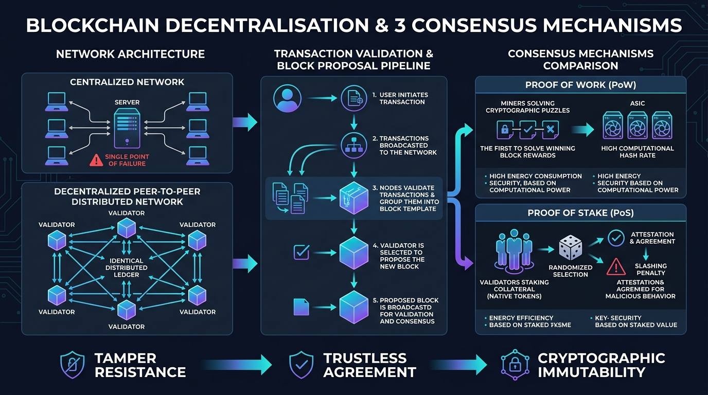

# Decentralisation and Consensus Mechanisms

## Decentralisation

Decentralisation is a structural and governance model where no single entity or central authority controls the network. Instead, operational authority, transaction validation, and ledger maintenance are distributed across independent, geographically dispersed nodes participating in a peer-to-peer network. This architecture strengthens the security and resilience of the network in two fundamental ways:



### Elimination of Single Points of Failure

In a centralized system, such as a conventional bank, the entire infrastructure relies on a central server or database. If that central server suffers hardware failure, network outages, or administrator compromise, the entire financial system halts or is corrupted.

In contrast, in a decentralized blockchain, every full node independently stores a complete copy of the ledger and autonomously validates all transactions. If an individual node is breached, goes offline, or broadcasts false data, the remaining nodes simply ignore it and continue processing valid transactions seamlessly without downtime.



### High Economic and Hash/Stake Barrier Against Ledger Rewriting (The 51% Threshold)

Because transaction validity is determined by distributed consensus rather than managerial decree, an attacker cannot arbitrarily rewrite transaction history or censor users unless they gain control of a strict majority of the network's consensus resource.

In a Proof of Work network, this requires commandeering more than 50% of the worldwide computational hash rate (a 51% attack); in Proof of Stake, it requires controlling a majority of the active staked capital. For sufficiently decentralized networks, acquiring this majority is economically prohibitive and practically infeasible.



**Example:** Bitcoin demonstrates this security model in production. As of 2024, Bitcoin operates across an estimated 15,000 to 50,000+ reachable and listening full nodes distributed across more than 100 countries, supported by an aggregate mining hash rate exceeding 600 Exahashes per second. Unlike a bank where compromising a central administrator grants unilateral control, compromising dozens or even hundreds of Bitcoin nodes has zero effect on the ledger's integrity. To censor a transaction or reverse past history, an attacker would need to purchase millions of specialized ASIC mining machines and secure several gigawatts of electrical power to outpace the remaining 50%+ of honest miners, creating an astronomical economic barrier.

## Consensus mechanisms

A consensus mechanism is a fault-tolerant protocol containing the rules that enable independent, mutually distrusting nodes in a distributed network to agree on a single, canonical state of the blockchain and the chronological ordering of transactions.

### Proof of Work (PoW)

* **Who proposes a block:** Miners compete to propose new blocks. Miners assemble pending transactions from their local memory pool, verify their signatures and account balances, and construct a candidate block.
*   **Validation rule (The Cryptographic Puzzle & Difficulty Target):** To validate and append a candidate block, miners must solve a computationally intensive proof-of-work puzzle. Specifically, the miner must find an arbitrary 32-bit number called a nonce such that when the block header—containing the previous block hash, Merkle root of transactions, timestamp, difficulty bits, and nonce—is hashed using the SHA-256 cryptographic algorithm, the resulting hash is strictly lower than a mathematically defined **difficulty target**.

    Because cryptographic hash outputs are pseudo-random and unpredictable, miners must expend vast amounts of brute-force computational power trying billions of different nonces per second. The network automatically adjusts the difficulty target, in Bitcoin every 2,016 blocks or approximately every two weeks, to ensure blocks are discovered at an average rate of one every 10 minutes, irrespective of hardware improvements or fluctuations in total hash power.
*   **Rejection rule & The Longest Chain Rule:** When a miner broadcasts a discovered block, receiving nodes independently inspect every element. Nodes reject any block if:

    1. The double-SHA-256 hash of the header does not meet the current difficulty target.
    2. Any transaction within the block is invalid, such as a fraudulent cryptographic signature, invalid inputs, or attempted double-spend.
    3. The `previous_block_hash` does not link to an existing valid block.

    Furthermore, when two valid blocks are mined almost simultaneously, creating a temporary fork, nodes follow the **longest chain rule**—more accurately, the chain with the greatest cumulative accumulated Proof of Work (Nakamoto, 2008, Section 4). Nodes always build on the chain representing the most computational effort, automatically orphaning and discarding competing branches with less accumulated difficulty.

### Proof of Stake (PoS)

* **Who proposes a block:** Validators propose blocks. Instead of expending electricity and computational hardware, participants deposit and lock up native cryptocurrency as collateral, such as exactly 32 ETH in Ethereum. For each time slot—12 seconds in Ethereum—the protocol's pseudo-random selection algorithm, such as RANDAO, selects an individual validator from the active validator pool to serve as the block proposer.
*   **Validation rule (Attestation Committees & Supermajority Finality):** A block proposal is not unilaterally accepted upon broadcast. Instead, the protocol randomly assigns other active validators into distinct **attestation committees**. These committee members independently verify the block's transactions and state execution, and then cast cryptographically signed votes known as **attestations**.

    These attestations endorse both the proposed block and the validator's view of the canonical chain head. To achieve deterministic finality, a block must receive a **two-thirds supermajority (>66.7%)** of all active staked validator attestations across two consecutive checkpoints/epochs, permanently cementing the state into the ledger.
*   **Rejection rule & Slashing:** Nodes and validators immediately reject any proposed block containing invalid state transitions, forged transactions, or conflicting historical roots. If a proposer broadcasts an invalid block, attestation committees refuse to sign it, causing the block to be discarded.

    To disincentivize malicious behaviour, Proof of Stake enforces **slashing**. Slashing is a protocol-level punitive mechanism triggered by provable cryptographic misconduct, specifically:

    1. **Equivocation / Double Proposing:** A block proposer proposing two different conflicting blocks for the same slot.
    2. **Double Voting / Surround Voting:** A validator submitting conflicting attestations for two different blocks at the same slot or voting across conflicting checkpoint epochs.

    When an infraction is detected, the protocol automatically penalizes the offending validator: a significant portion of their staked capital, up to their entire 32 ETH deposit during coordinated attacks, is permanently destroyed (burned), and the validator is forcefully dishonorably discharged and ejected from the validator set.

### Comparison: Proof of Work vs. Proof of Stake

| Feature                          | Proof of Work (PoW)                                                                 | Proof of Stake (PoS)                                                            |
| -------------------------------- | ----------------------------------------------------------------------------------- | ------------------------------------------------------------------------------- |
| **Block Proposer**               | Miner who first discovers a valid nonce hash                                        | Pseudo-randomly selected validator from the active staking pool                 |
| **Validation Mechanism**         | Brute-force computational hashing below the dynamic difficulty target               | Cryptographic attestations (votes) from randomized validator committees         |
| **Fork-Choice / Agreement Rule** | Longest chain rule (chain with greatest accumulated Proof of Work)                  | LMD-GHOST fork choice with Casper FFG 2/3 supermajority checkpoint finality     |
| **Penalty for Dishonesty**       | Sunk cost of wasted electrical power and hardware depreciation on an orphaned block | **Slashing**: Destruction (burning) of staked collateral and permanent ejection |
| **Resource Dependency**          | Specialized hardware (ASICs) and continuous electrical power consumption            | Capital lockup (staked native cryptocurrency tokens)                            |
| **Notable Examples**             | Bitcoin, Litecoin, Dogecoin                                                         | Ethereum, Cardano, Polkadot                                                     |

## How decentralisation and consensus work together

Decentralisation and consensus mechanisms are symbiotic: decentralisation supplies the permissionless, distributed topology that prevents central control or censorship, while the consensus mechanism provides the algorithmic rules that allow those distrusting nodes to coordinate and maintain a unified truth. Together, they make the blockchain tamper-resistant through cryptographic hash-linking and astronomical economic attack costs.

### The Hash-Link Immutability Argument

The tamper resistance of a blockchain relies directly on its cryptographic data structure. In a blockchain, transactions are bundled into discrete blocks, and every single block header includes the exact cryptographic hash of the preceding block's header (`previous_block_hash`), creating an unbroken backwards-pointing chain of cryptographic hashes.

Cryptographic hash functions, such as SHA-256, possess two critical mathematical properties: **pre-image resistance** (one-way computation) and the **avalanche effect** (changing even a single bit of input completely scrambles the output hash). If an attacker attempts to modify a historical transaction in a block:



### The modified transaction alters the Merkle root of that block



### The altered Merkle root changes the header hash of that block



### The cryptographic link between blocks breaks

Because the next block explicitly references the original hash of the previous block, the cryptographic link between them instantly breaks.



### All subsequent blocks become invalid

All subsequent blocks become mathematically invalid according to the network's consensus validation rules.



Consequently, to successfully alter a past transaction, an attacker cannot simply modify that single block. Under the longest chain rule, they must re-solve the consensus requirements—re-mining the Proof of Work puzzle and finding a new valid nonce, or generating fraudulent 2/3 attestations in PoS—for the modified block **and every single block added to the chain since then**, all while the honest distributed network continues to extend the valid chain at full capacity.

### Bitcoin Security Outcome

In Bitcoin, Nakamoto proved mathematically that as the number of confirming blocks grows, an attacker's probability of catching up and replacing the honest chain drops exponentially toward zero. Because Bitcoin's consensus is maintained by thousands of independent nodes and over 600 EH/s of mining power, modifying a block confirmed several blocks ago would require an attacker to command more computational power than the rest of the worldwide network combined for an extended duration. The physical impossibility of commandeering this volume of energy and hardware guarantees that confirmed Bitcoin transactions achieve irreversible, tamper-resistant finality.

## Real-world examples

### The Ethereum Classic 51% Attacks (2019): The Vulnerability of Minority Hash Chains

In January 2019, the Ethereum Classic (ETC) blockchain suffered a series of successful 51% attacks and chain reorganizations that directly demonstrated the limitations of Proof of Work on minority chains. Ethereum Classic is a Proof of Work chain that shares the Ethash hashing algorithm with Ethereum (prior to the Merge), but commanded less than 5% of Ethereum's total hash power at the time.

Taking advantage of this vulnerability, an attacker acquired majority hash power on ETC—largely by renting GPU hash power through cloud marketplaces like NiceHash—and secretly mined a private fork of the blockchain containing double-spend transactions. The attacker deposited ETC onto crypto exchanges, such as Gate.io and Coinbase, traded it for other cryptocurrencies, withdrew the proceeds, and then broadcast their secretly mined private chain to the public network.

Because the attacker's private chain contained more accumulated difficulty than the public chain, the consensus client software across the network automatically followed the longest chain rule and accepted the deep reorganization (reorg) of over 100 blocks. As a result, the double-spends succeeded on-chain, defrauding exchanges of over $1.1 million in ETC.


**Analytical Takeaway:** This incident demonstrates that Proof of Work does not magically guarantee tamper resistance in isolation. Without a sufficiently large, decentralized distribution of hash power, an attacker can economically rent majority power to rewrite history, and the mathematical rules of consensus—the longest chain rule—will enforce the attacker's malicious reorganization. In response, exchanges did not reverse the blockchain; instead, they had to drastically increase confirmation thresholds, to hundreds or thousands of blocks, to protect against further reorgs.


### The Ethereum Merge (2022): Upgrading Consensus and Economic Security

On 15 September 2022, the Ethereum network completed "The Merge," a landmark upgrade that transitioned its consensus layer from Proof of Work to Proof of Stake by merging the original execution layer with the Beacon Chain (ethereum.org).

It is important to clarify that The Merge was **not** a scalability or throughput upgrade; it did not increase block capacity or reduce transaction gas fees, which are addressed through Layer 2 rollups and danksharding. Instead, The Merge was specifically designed to resolve two fundamental challenges:



### Environmental Sustainability

It eliminated the need for computational brute-force mining, cutting Ethereum's worldwide electrical energy consumption by approximately **99.95%** overnight.



### Economic Security and Attack Deterrence

Under Proof of Stake, launching a 51% attack requires an adversary to acquire and stake more than 50% of the entire network's staked ether, and over 66.7% to control finality. With over 30 million ETH staked, representing tens of billions of dollars in market capital, acquiring such a massive fraction of supply on the open market would create extreme upward price slippage, rendering the capital requirement economically absurd.



Furthermore, unlike Proof of Work where a defeated 51% attacker retains their physical ASIC hardware to attack again, a 51% attacker on Ethereum faces immediate protocol-level **slashing**: the network automatically burns their staked collateral. If an attacker manages to temporarily stall the chain, the honest distributed validator community can coordinate a social soft fork or inactivity leak to permanently destroy the attacker's validator deposits without needing to buy new hardware. This demonstrates how the transition to PoS enhanced Ethereum's economic security and resistance against reorganization attacks.

## Diagram&#x20;

<figure><figcaption></figcaption></figure>

_Figure 1: Comparison of Centralized vs Decentralized Network Architectures, Transaction & Block Proposal Pipeline, and Proof of Work (PoW) vs Proof of Stake (PoS) Consensus Mechanisms._

## References

* Nakamoto, S. (2008). _Bitcoin: A Peer-to-Peer Electronic Cash System_. Available at: [https://bitcoin.org/bitcoin.pdf](https://bitcoin.org/bitcoin.pdf)
* Ethereum Foundation. (2024). _Consensus Mechanisms: Proof-of-work (PoW) and Proof-of-stake (PoS)_. ethereum.org. Available at: [https://ethereum.org/developers/docs/consensus-mechanisms/](https://ethereum.org/developers/docs/consensus-mechanisms/)
* Ethereum Foundation. (2024). _The Merge_. ethereum.org. Available at: [https://ethereum.org/roadmap/merge/](https://ethereum.org/roadmap/merge/)
* Nesbitt, M. / Coinbase Security. (2019). _Ethereum Classic (ETC) is currently being 51% attacked_. Coinbase Blog. Available at: [https://www.coinbase.com/blog/ethereum-classic-etc-is-currently-being-51-attacked](https://www.coinbase.com/blog/ethereum-classic-etc-is-currently-being-51-attacked)
* Gate.io. (2019). _Ethereum Classic 51% Attack and Double-Spend Incident Report_. Available at: [https://www.gate.io/announcements/](https://www.gate.io/announcements/)
* Fidelity Investments. (2025). _"Ethereum Merge: What it is and what it means for crypto investors."_ Available at: [https://www.fidelity.com/learning-center/trading-investing/ethereum-merge](https://www.fidelity.com/learning-center/trading-investing/ethereum-merge)
* Ethereum Stack Exchange. (2022). _"How do nodes reject a fraudulent block?"_ Available at: [https://ethereum.stackexchange.com/questions/119712/how-do-nodes-reject-a-fraudulent-block](https://ethereum.stackexchange.com/questions/119712/how-do-nodes-reject-a-fraudulent-block)
